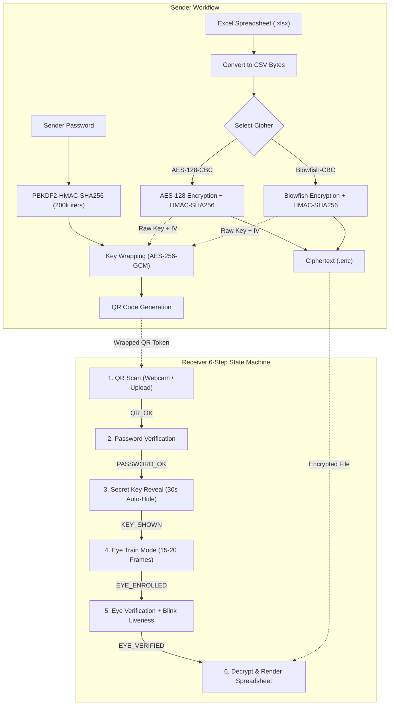

# QR Code-Based Secure Key Exchange for Encrypted File Sharing with Biometric Eye-Scan Authentication

An enterprise-grade, multi-factor zero-trust cryptographic file exchange system extending **AES-128-CBC** and **Blowfish-CBC** file encryption with:
1. **Password-Derived Key Wrapping (PBKDF2 + AES-256-GCM)** preventing raw cryptographic key leakage in QR codes.
2. **Biometric Periocular/Iris Eye-Scan Module** powered by facial landmark localization, spatial LBP histograms, and concentric annular ring statistics.
3. **Active Blink Liveness Verification** thwarting high-resolution photo replays and video playback spoofing.
4. **Server-Enforced 6-Step Receiver State Machine** strictly blocking any out-of-order access with HTTP 403.
5. **Security Rate Limiting & Lockout Engine** (5 password tries or 3 eye mismatches locks transfer for 15 minutes).
6. **Immutable Audit Logging** tracking all security events with zero secrets recorded.

---

> [!NOTE]
> **Webcam Biometric Scope:** Standard RGB webcams provide **periocular / iris-region recognition** under ambient visible spectrum illumination. True medical-grade or forensic iris recognition (e.g. ISO/IEC 19794-6) requires dedicated Near-Infrared (NIR 700–900 nm) illumination and high-magnification IR sensors to illuminate intricate stroma patterns independent of eye color and ambient reflections.

---

## 1. System Architecture



---

## 2. Strict 6-Step Receiver State Machine

All endpoints enforce transitions via the server session state machine:
$$\text{INITIAL} \longrightarrow \text{QR\_OK} \longrightarrow \text{PASSWORD\_OK} \longrightarrow \text{KEY\_SHOWN} \longrightarrow \text{EYE\_ENROLLED} \longrightarrow \text{EYE\_VERIFIED} \longrightarrow \text{DATA\_VIEW}$$

| Step | State | Action & Security Enforcement | Out-of-Order Behavior |
| :--- | :--- | :--- | :--- |
| **1. QR Scan** | `QR_OK` | Receiver scans or uploads QR code. Extracts encrypted envelope and verifies transfer existence. | Re-initializes session. |
| **2. Password** | `PASSWORD_OK` | Verifies transfer password against salted hash and unwraps AES/Blowfish key using AES-256-GCM. 5 failed attempts trigger lockout. | HTTP 403 Forbidden |
| **3. Key Reveal** | `KEY_SHOWN` | Displays unwrapped secret key and IV in masked format. Includes a "Reveal" button and auto-hides after 30 seconds. **Never logged to disk or audit trail.** | HTTP 403 Forbidden |
| **4. Eye Train** | `EYE_ENROLLED` | Captures 15–20 webcam frames. Rejects blurry (Laplacian variance < 35) or dark frames. Computes centroid embedding and encrypts template at rest via AES-GCM. | HTTP 403 Forbidden |
| **5. Eye Verify** | `EYE_VERIFIED` | Active blink challenge (EAR drop & recovery) + cosine similarity matching ($\ge 0.90$). Maximum 3 attempts before 15-minute transfer lock. | HTTP 403 Forbidden |
| **6. View Data** | `DATA_VIEW` | Decrypts ciphertext in-memory, renders interactive data table in browser, and provides download button for decrypted `.xlsx` spreadsheet. | HTTP 403 Forbidden |

---

## 3. Installation & Setup

### Prerequisites
- Python 3.10+ (tested on Python 3.11, 3.12, 3.13)
- Modern web browser (Chrome, Edge, Firefox, or Safari) with webcam access

### Setup Steps

1. **Clone or navigate to workspace:**
   ```bash
   cd c:\Users\trasr\OneDrive\Desktop\CRYPTO-CP
   ```

2. **Install dependencies:**
   ```bash
   pip install -r requirements.txt
   ```

3. **Verify installation & run complete test suite:**
   ```bash
   python run_all_tests.py
   ```
   *Expected output: `Ran 20 tests in ~4s ... OK`*

4. **Start the Flask web application:**
   ```bash
   python app.py
   ```
   The portal will be live at: **`http://127.0.0.1:5000`**

---

## 4. End-to-End Demo Script

### Step 1: Sender Portal (`http://127.0.0.1:5000/sender`)
1. Click **"Load Sample Legal Contract.xlsx"** (or choose any `.xlsx` file).
2. Choose **AES-128-CBC** (or Blowfish-CBC for comparison).
3. Set password: `CapstoneSecret#2026`.
4. Click **"Encrypt File & Generate Wrapped QR"**.
5. Observe:
   - Encryption benchmark results: Encryption time (ms) and throughput (KB/s).
   - Generated QR code containing the wrapped key envelope.
   - Click **"Proceed to Receiver Flow"** (the QR token is automatically passed forward).

### Step 2: Receiver Portal (`http://127.0.0.1:5000/receiver`)
1. **Step 1 (QR Scan):** Click **"Submit Token"** (pre-filled with the active transfer) or scan/upload the QR image. State advances to `QR_OK`.
2. **Step 2 (Password):** Enter `CapstoneSecret#2026` and click **"Verify & Unwrap Key"**.
3. **Step 3 (Key Reveal):** View the masked key. Click **"Reveal Key"** to inspect the hex representation; note the 30-second live countdown timer. Click **"Proceed to Step 4"**.
4. **Step 4 (Eye Train Mode):** Allow camera permissions and click **"Start Eye Scan Capture"**. Look into the webcam; the progress bar tracks quality frames from 1 to 20 and saves the encrypted template.
5. **Step 5 (Eye Verify):** Click **"Start Live Eye Verification"**. Look at the camera and **blink naturally**. The system detects the EAR change, verifies liveness, computes cosine similarity (> 90%), and grants access.
6. **Step 6 (View Data):** The confidential contract is decrypted in-memory and rendered in a searchable HTML table. Click **"Download Decrypted Excel (.xlsx)"** to save the restored workbook.

---

## 5. Security & Threat Modeling

| Threat Vector | Attack Scenario | Countermeasure Implemented |
| :--- | :--- | :--- |
| **Stolen QR Code** | Adversary photographs or intercepts QR code. | Keys are wrapped with **AES-256-GCM** using a key derived from the password via **PBKDF2-HMAC-SHA256 (200k iterations)** with 16-byte random salt. Raw keys are never in the QR. |
| **Ciphertext Tampering** | Adversary alters bytes in stored ciphertext file (`.enc`). | **Encrypt-then-MAC (HMAC-SHA256)** verifies integrity over $(IV + C)$ before decryption; tampering raises an immediate integrity error. |
| **Brute-Force Passwords** | Automated dictionary attack on receiver password. | **Rate-limiting lockout** locks the transfer after 5 incorrect attempts for 15 minutes. Passwords hashed using PBKDF2 with random salt. |
| **Biometric Photo Replay** | Attacker holds high-res smartphone photo or printout in front of camera. | **Active Blink Liveness Challenge** tracks Eye Aspect Ratio (EAR). Static images have 0 EAR delta and fail immediately. |
| **Biometric Imposter** | Unauthorized person attempts to verify against receiver's template. | **Multi-feature fusion** (spatial LBP histograms + concentric annular rings) evaluated via cosine similarity against a strict 0.90 threshold. 3 failed attempts triggers a 15-minute lock. |
| **Biometric Database Breach** | Attacker dumps the SQLite database. | **Templates encrypted at rest** with AES-256-GCM using `BIOMETRIC_SECRET_KEY`. Raw images and video frames are never saved to disk. |
| **Endpoint Bypass** | Adversary calls `/api/receiver/view-data` directly without completing steps. | **Session-level State Machine** checks prerequisite states (`INITIAL` &rarr; `QR_OK` &rarr; `PASSWORD_OK` &rarr; `KEY_SHOWN` &rarr; `EYE_ENROLLED` &rarr; `EYE_VERIFIED` &rarr; `DATA_VIEW`). Out-of-order calls return **HTTP 403 Forbidden**. |
| **Side-Channel Secret Leakage** | Secret keys logged in server console, exceptions, or access logs. | Secret keys are revealed in memory only during active session and are **strictly excluded from audit logs and disk writes**. |

---

## 6. Performance Benchmarks

Navigate to `http://127.0.0.1:5000/comparison` to execute the real-time comparative benchmark suite comparing **AES-128-CBC** against **Blowfish-CBC** across payload sizes from 10 KB to 1 MB:

- **AES-128-CBC:** Demonstrates superior throughput (~200,000+ KB/s) utilizing hardware-accelerated AES-NI instructions.
- **Blowfish-CBC:** Kept for quantitative comparison, exhibiting lower throughput (~45,000–60,000 KB/s) due to its 64-bit block size and lack of direct hardware pipeline support.

